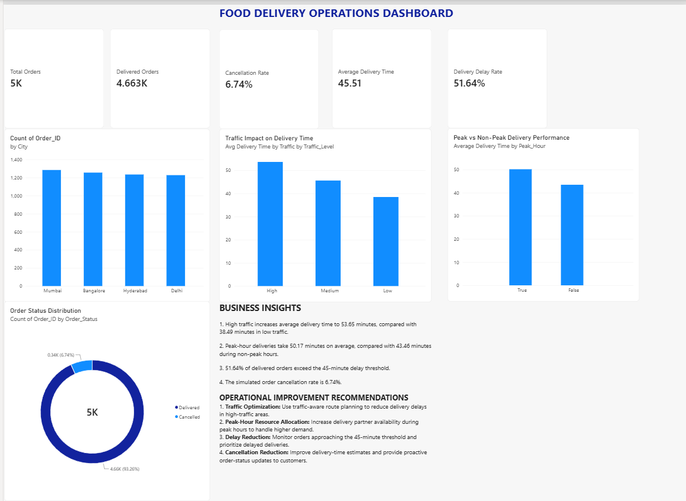

# Food Delivery Operations Analytics & Optimization

## Project Overview
An end-to-end operations analytics project using 5,000 synthetically generated food delivery orders.

The project analyzes delivery performance, traffic conditions, peak-hour demand, cancellations, and operational bottlenecks.

## Technologies Used
- Python (Pandas, NumPy, Matplotlib)
- SQL (SQLite)
- Power BI
- DAX

## Key Performance Indicators

| KPI | Result |
|---|---|
| Total Orders | 5,000 |
| Delivered Orders | 4,663 |
| Cancellation Rate | 6.74% |
| Average Delivery Time | 45.51 minutes |
| Delivery Delay Rate | 51.64% |

## Key Findings
- High-traffic deliveries averaged 53.65 minutes versus 38.49 minutes in low traffic.
- Peak-hour deliveries averaged 50.17 minutes versus 43.46 minutes during non-peak hours.
- 51.64% of delivered orders exceeded the simulated 45-minute delay threshold.

## Proposed Operational Improvements
1. Introduce traffic-aware route planning.
2. Adjust delivery-partner allocation during peak hours.
3. Monitor orders approaching the 45-minute delay threshold.
4. Improve estimated delivery times and proactive order-status updates.

## Dashboard Preview

## Project Structure
- `data/` — synthetic dataset and SQLite database
- `scripts/` — dataset generation, analysis, visualization, and SQL scripts
- `sql/` — SQL analysis queries
- `reports/` — generated charts
- `dashboard/` — Power BI dashboard
- `screenshots/` — dashboard preview

## Data Disclaimer
All 5,000 orders are synthetic and generated for educational and portfolio purposes. Findings and recommendations are illustrative, not validated outcomes from a real delivery platform.
  